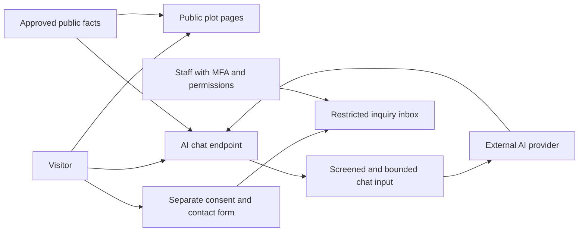

# Recommended Technology and Architecture

Last updated: 23 October 2026, Asia/Dhaka. Status: first local Django milestone implemented; production infrastructure, AI and inquiry persistence remain planned.

## Recommended stack

| Layer | Recommendation | Reason |
| --- | --- | --- |
| Backend | Django 5.2 LTS, latest security patch | Matches the user's choice and offers a longer support window |
| Runtime | Python 3.13, latest supported micro release | Supported by Django 5.2; confirm host availability |
| Frontend | Django templates, semantic HTML, small JavaScript modules | Fast initial rendering, SEO, modest complexity, one application |
| CSS | Custom CSS with V3 tokens and self-hosted Noto fonts | Implemented to match the approved direction without a framework build step |
| Database | PostgreSQL 17, latest patch | Reliable relational data, transactional updates, supported production database |
| Staff administration | Django admin with focused forms and permission checks | Fits two listings and a small staff team without a separate dashboard product |
| Bilingual content | Django i18n plus explicit Bangla/English fields | Simple for a fixed two-language catalog; human-approved translations |
| Images | Pillow, validated and normalized uploads, responsive generated sizes | Efficient delivery and safer media handling |
| Video | HTML video with poster, captions, and bounded approved MP4 uploads | Uses existing assets without another streaming integration |
| Panorama | Self-hosted Pannellum, pinned release | Uses supplied 360° imagery and loads only when requested |
| AI | Server-side OpenAI Responses API adapter; GPT-5.4 mini as an evaluation candidate | Free-text bilingual assistance with bounded context and a replaceable provider |
| Authentication | Django staff authentication plus a maintained MFA integration | No customer authentication; secure staff access is essential |
| Production process | Gunicorn behind a managed HTTPS ingress, or Nginx on a managed VPS | Conventional Django deployment; final choice depends on the host |
| Dependencies | A project virtual environment and pinned dependency lock/export, managed with uv | Repeatable local/CI/production environments |
| Quality and security | Django tests, Ruff, Bandit, pip-audit, Gitleaks, accessibility checks | Small, practical automated checks; detailed policy in SECURITY.md |

Django's [support table](https://www.djangoproject.com/download/) lists 5.2 LTS extended support through April 2028. Its [installation FAQ](https://docs.djangoproject.com/en/5.2/faq/install/) supports Python 3.13 and recommends PostgreSQL for production. PostgreSQL 17 is supported through November 2029 according to its [versioning policy](https://www.postgresql.org/support/versioning/). Recheck exact patches at implementation and each release.

The first build uses custom CSS, semantic HTML, native dialogs and a small JavaScript module. Fonts, viewer scripts and licenses are bundled locally. No npm build step is needed. Apply the DESIGN.md responsive, focus, contrast and localization requirements; full accessibility verification remains a later release task.

## Alternatives considered

| Option | Assessment |
| --- | --- |
| React or Next.js with a Django API | Adds two application layers, API/auth concerns, and build/deployment work for a small content site; revisit for genuinely complex client workflows |
| Tailwind CSS | Good for a bespoke design and worth reconsidering if the maintainer knows it; Bootstrap plus custom CSS is the simpler starting proposal while team skills are unknown |
| Plain custom CSS only | Selected for the first implementation; keeps the V3 presentation and dependency surface small |
| HTMX | Useful for later partial updates; unnecessary for two listings and a small chat module |
| Wagtail | Useful for a large editorial site; adds CMS concepts and dependencies not needed for the current inventory |
| SQLite | Used for local preview/tests because PostgreSQL/Docker are unavailable here; PostgreSQL integration must pass before staging/production |
| MySQL | Supported by Django, but offers no clear advantage for this new project |

Do not introduce a vector database, LangChain, an autonomous agent framework, microservices, Redis, Celery, Elasticsearch, or a REST framework at the start. Add a dependency only for a concrete requirement and record the maintenance, security, license, and privacy implications.

## Proposed application modules

    config/       environment settings, URLs, deployment configuration
    website/      public company pages, approved contacts, FAQ content
    projects/     implemented listings, bilingual facts, public queries, photo uploads, publication gate
    inquiries/    contact form, consent record, restricted staff inbox
    assistant/    public fact context, provider adapter, quotas, safe responses
    templates/    shared layout and accessible page/components
    static/       project CSS/JS, approved logo exports, vendored libraries/fonts
    tests/        integration, access control, privacy, abuse, and AI evaluation

The implemented code is in app/: config/, website/, projects/, templates/, static/ and tests/. Separate inquiries/ and assistant/ services are still planned. See app/README.md for commands and limits. Runtime Django 5.2.18/Python 3.13, pinned dependencies and PostgreSQL CI configuration are present; the CI service has not yet executed.

## Data boundaries

Public browser requests go to Django. Django reads only published plot/company data for public responses. Staff routes use authentication, MFA, and explicit permissions. PostgreSQL and storage are reached from the server and are not public administration interfaces.

The assistant's service can build a small context from the two approved listings and FAQs. An AI provider request contains that public context and bounded, screened conversational input. It must not contain lead-form fields, staff credentials, private documents, internal notes, or the full database.

Interest submission goes through a separate Django form into the restricted inquiry table. The model has no tool or route to query or modify leads. Staff review the inbox manually. A later email notification should contain a link to the protected inbox rather than customer details.

The diagram shows intended data boundaries, not existing services. Lead-form details stay on the form/inbox path and do not enter the AI path.

## Proposed data model

| Entity | Minimum useful information |
| --- | --- |
| Plot | Stable ID/slug, bilingual title/description, location, approved coordinates, area, unit convention, decimal price, price basis, availability, publishing state, review/update timestamps |
| PlotMedia | Plot association, media type, file reference, bilingual caption/alternative text, actual-photo/render label, review state, order |
| FAQ / SiteContact | Approved bilingual public facts and public business contacts |
| Inquiry | Optional name, callback phone, plot reference, optional bounded message, consent timestamp/text version, created time, handling status, retention expiry |
| Staff user | Individual Django account, MFA enrollment, group permissions; no customer user accounts |
| Audit event | Staff actor ID, action, affected record reference, timestamp; avoid copying lead contents |

The user renamed the two public listings Project 01 and Project 02 on 23 October. Use Projects wording in UI and public-facing assistant answers. The implemented internal models are Project, ProjectImage and FAQ; Inquiry, SiteContact and audit-event work remains planned. The public rename alone does not require separate parent Project and child Plot models or a hierarchy. Store timestamps in UTC and show staff dates in Asia/Dhaka. Store money and measurements using decimal types. Keep internal primary keys independent of editable public labels.

## Content and publishing

Target workflow: staff create or update content, preview it, and publish only after required facts and both language versions are approved. First milestone: MFA and explicit publication permission are enforced; non-publishers cannot edit live records, and permitted managers edit the current row directly. Separate draft revisions/review remain to be built. The exact editor/approver split awaits role confirmation. Keep archive state separate from sales status. Restrict public queries, chat context, sitemaps, and media exposure consistently.

Media uploaded by staff still needs validation. Re-encode supported images, strip unnecessary metadata, reject active file types, validate size/dimensions, and use generated storage names. Set separate limits for ordinary photos, panoramas, and videos after inspecting the supplied assets. Do not expose private documents through a public media path.

## AI recommendation and constraints

Recommend an OpenAI Responses API integration through a small provider adapter, subject to company approval of budget and data handling. [GPT-5.4 mini](https://developers.openai.com/api/docs/models/gpt-5.4-mini) is a documented efficient model candidate, not a proven best Bangla model for this use case. Select and pin an available version only after testing representative Bangla, English, and mixed-language questions, factual accuracy, latency, and cost.

Do not enable web browsing, file search, arbitrary URL fetching, code execution, or administrative tools. Use public, approved facts supplied directly by the application. Keep prompt/configuration versions so an evaluation can be repeated after changes.

Use explicit timeouts, bounded turns and input/output tokens, global and per-session quotas, and an application-enforced spend ceiling. Start with non-streamed replies for simplicity unless measured latency warrants streaming; provider exceptions must resolve to a useful bilingual fallback, not a trace or sensitive payload.

Keep conversational history in volatile browser memory where practical, with bounded server processing and no durable transcript store. Treat any history received from the browser as untrusted input. Avoid provider conversation objects and persisted response chains for this MVP. Set response storage off where supported and distinguish this from provider abuse-monitoring retention.

The provider's [data controls](https://developers.openai.com/api/docs/guides/your-data) state that API data is not used for training by default, but standard abuse-monitoring retention can still apply. Storage settings alone do not establish zero retention. Assess actual account settings, terms, processing location, and Bangladesh transfer requirements before production use.

## Hosting proposal

The company has not supplied its domain/hosting information. Do not assume the existing WordPress-oriented hosting can run Django. Request a provider/plan inventory through the company without asking for credentials in chat.

Prefer a managed Python application host with PostgreSQL, verified TLS, secret management, persistent/object storage, backup restoration, log controls, and accessible support. A managed VPS is a fallback if budget or location requires it and the teammate can operate it. Hosting location needs a privacy review, not a guess that domestic customers automatically require or exempt a particular region.

Separate staging and production, credentials, databases, and billing. Use synthetic staging data. Existing domains and websites remain untouched until the company approves a concrete migration plan with backup, redirects, DNS change, and rollback.

## Performance and SEO

Render readable content on the server. Generate responsive photos; avoid sending the 7284px logo unchanged. Reserve media dimensions to prevent layout movement. Defer chat code and large media until needed. Never include an API secret in browser assets.

Use descriptive URLs, bilingual titles/descriptions, correct page language, canonical URLs, alternate language links, and a sitemap containing published pages only. Do not invent reviews or structured-data claims. Add social preview images from licensed company assets.

Adopt [Core Web Vitals](https://web.dev/articles/vitals) targets of LCP at most 2.5s, INP at most 200ms, and CLS at most 0.1 at the 75th percentile once enough real visits exist. Before launch, use controlled mobile lab tests and record their conditions; lab scores cannot prove field performance. Initial page media budgets and panorama/video limits are set after asset inspection.
