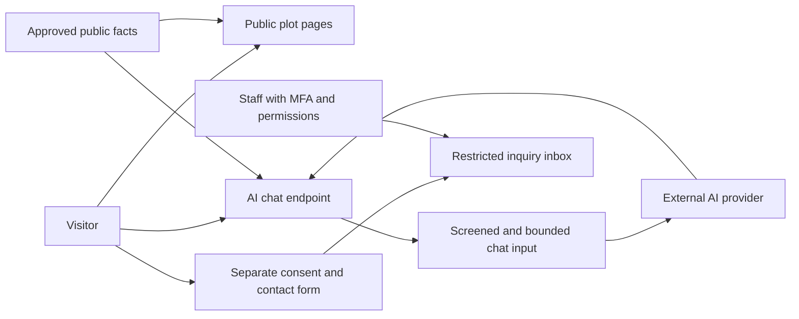

# Tech stack

Last updated 21 November 2026.

## In use

| Layer | Choice | Notes |
| --- | --- | --- |
| Language | Python 3.13.16 | Pinned in `.python-version`; CI uses the same version |
| Framework | Django 5.2.18 | LTS release, supported until April 2028 |
| Database | PostgreSQL 17 in CI and production; SQLite for local development only | Production refuses SQLite and PostgreSQL without TLS |
| Frontend | Django templates, custom CSS, one small `site.js` | No build step, no npm |
| Fonts and viewer | Noto Sans, Noto Sans Bengali, Pannellum 2.5.7, all self-hosted | Sources and checksums in `app/static/vendor/MANIFEST.json` |
| Images | Pillow | Uploads are checked, rotated from EXIF, re-encoded to JPEG and capped at 2400 px |
| Staff sign-in | Django auth, django-two-factor-auth (TOTP), django-axes (lockout) | Passwords hashed with scrypt |
| Static files | WhiteNoise, hashed and compressed | |
| App server | Gunicorn | In the lock file; not configured yet |
| Dependencies | `requirements*.in` compiled to hashed `requirements*.lock` with `uv pip compile` | Install with `pip --require-hashes` |
| Checks | Django tests, Ruff, Bandit, pip-audit, Gitleaks | Run locally and in GitHub Actions |

## Code layout

```text
app/
  config/      settings, URLs, MFA-only admin site, security-headers middleware
  projects/    Project, ProjectImage and FAQ models; admin; protected image view; seed_demo command
  website/     public views, inquiry form, bilingual copy (copy.py), template filters
  templates/   base layout, pages, components, staff sign-in, admin branding
  static/      CSS, JS, fonts, sample images and videos, vendored Pannellum
  tests/       test_foundation.py (pages, privacy, staff, media), test_security.py (config, headers, sign-in)
scripts/
  dev.sh                migrate, seed and run on 127.0.0.1:8000
  check_production.py   Django deployment checks against a synthetic production config
  install-gitleaks.sh   installs a checksum-pinned Gitleaks into .runtime/tools
  prepare_assets.py     one-off WebP exports and vendored package downloads
```

Planned apps: `inquiries/` (form, consent record, staff inbox) and `assistant/` (public-fact context, provider adapter, quotas).

## Data model

Built:

| Model | Key fields |
| --- | --- |
| Project | slug; title, location and description in `_en` and `_bn`; `price_bdt`, `area_katha`, `area_sqft` (decimals, database-checked above zero); publication (draft, published, archived); availability; `is_sample`; order |
| ProjectImage | UUID id; project; image (re-encoded JPEG); caption and alt text in both languages; `illustrative`, `rights_confirmed`, `approved_for_publication`; order |
| FAQ | question and answer in both languages; published; order |

Planned:

- **Inquiry:** optional name, phone, project, short message, consent time and notice version, status, retention expiry.
- **SiteContact:** approved public contacts.
- **AuditEvent:** staff id, action, record and time, with no lead contents.

Timestamps are stored in UTC and shown in Asia/Dhaka time. Internal keys stay separate from labels staff can edit.

## Data boundaries

Public requests read only published data. Staff routes need a login, MFA and the right permission. Only the server can reach the database and file storage.

The future AI feature gets a small context built from published listings and FAQs, plus screened chat input. It never gets inquiry fields, credentials, private documents or database access. Inquiries go through a separate form into a restricted table, and staff read them in the inbox. Email alerts should link to the inbox instead of containing customer details.



The diagram shows the intended design. Only the public pages and the staff admin exist today.

## Publishing

Today:

- Only users with `projects.publish_project` can publish a project or FAQ, approve photos, or change or delete live records, including through bulk delete. Other staff can edit drafts.
- A photo is public only when `rights_confirmed` and `approved_for_publication` are both set and its project is published.
- Unapproved photos are served only to MFA-verified staff with view permission, with `Cache-Control: private, no-store`.

Planned: draft revisions with preview and review, so editing never changes the live version until it's published.

## AI (planned)

- Candidate: OpenAI Responses API behind a small adapter, so the provider can be swapped, evaluating GPT-5.4 mini. Not decided. Test Bangla, English and mixed questions, accuracy, speed and cost first, then pin a model version.
- No web browsing, file search, URL fetching, code execution or admin tools.
- Timeouts, limited turns and tokens, global and per-session quotas, and a spending cap the app enforces. Provider errors show a bilingual fallback message, never a stack trace.
- Chat history stays in the browser and is treated as untrusted. No stored transcripts. Turn the provider's response storage off where possible. That still isn't zero retention, since abuse monitoring may apply. Check the actual account terms and Bangladesh's data-transfer rules first.

## Hosting (not chosen)

The company hasn't shared its domain or hosting details. Don't assume its current WordPress-style hosting can run Django. Prefer a managed Python host with PostgreSQL, TLS, secret management, persistent or object storage, tested backups and logs; a managed VPS is the fallback. Keep staging and production separate, with synthetic data in staging. Leave existing domains alone until the company approves a migration plan with a rollback.

Before deploying, fix open findings A07–A09 in [SECURITY_AUDIT.md](SECURITY_AUDIT.md#open-findings): logging, the health-check redirect and the proxy-aware client IP.

## Performance and SEO

- HTML is rendered on the server. Image sizes are reserved to avoid layout shift. Heavy media and viewer code load only on demand. No secrets in browser code.
- Targets once real traffic exists: LCP ≤ 2.5 s, INP ≤ 200 ms, CLS ≤ 0.1 (75th percentile).
- At launch: titles and descriptions in each language, canonical and alternate-language links, a sitemap of published pages, and social preview images. While everything is a sample, pages deliberately send `noindex,nofollow`.

## Alternatives we rejected

| Option | Why not, for now |
| --- | --- |
| React/Next.js with an API | Two apps and an API for a small content site |
| Tailwind or Bootstrap | An extra build step or defaults to override; custom CSS matches V3 |
| HTMX | Not needed for two listings |
| Wagtail | CMS concepts we don't need yet |
| MySQL | No advantage over PostgreSQL here |

Don't add a vector database, LangChain, an agent framework, microservices, Redis, Celery, Elasticsearch or a REST framework without a concrete need. For any new dependency, record its maintenance, security, licence and privacy cost.
